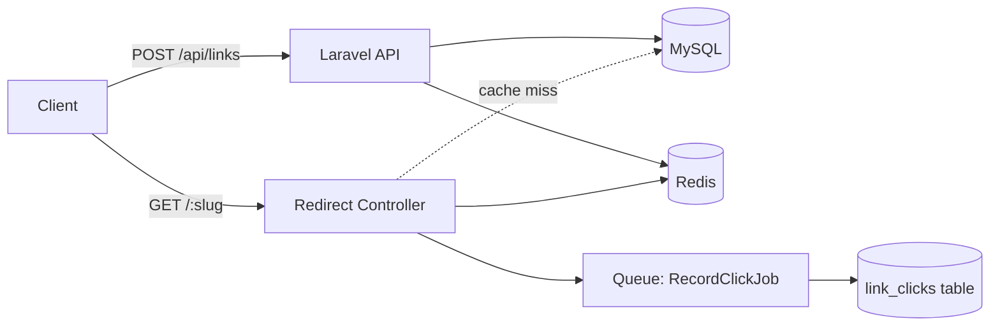

# URL Shortener — Laravel 11 + Redis

[CI results](https://github.com/umairjutt/url-shortener-laravel/actions) · [Engineering guide](PORTFOLIO.md)

> **Status:** Development API for Redis-backed redirects. Cached expiration, alias races and deployment assumptions require further validation.

A Laravel URL shortener API with click analytics, QR codes, custom aliases, and link expiration. Built to demonstrate Redis-backed caching, hit-counting, and clean Laravel architecture.

[API docs](#api-reference) · [Architecture](#architecture)

## What this demonstrates

- **Redis** for hot-path lookups (`O(1)` slug -> URL resolution, no DB round-trip)
- **Atomic click counting** with `Redis::incr` flushed to MySQL by a queued job
- **Base62 hashing** + collision-safe custom alias reservation
- **Geo/device analytics** parsed from User-Agent + CF-IPCountry headers
- **QR code generation** (`simple-qrcode`) cached on disk
- **Rate limiting** per IP (5 short-link creates / minute) using Laravel's RateLimiter
- **Test coverage** with Pest (feature + unit)
- **Local containers** — follow the complete quick-start sequence below

## Architecture



## Tech stack

- Laravel 11, PHP 8.3
- MySQL 8 (persistent storage)
- Redis 7 (slug cache + click counter + rate limiter)
- Pest 3 (tests)
- `simplesoftwareio/simple-qrcode` (QR generation)
- `jenssegers/agent` (UA parsing)

## Quick start

```bash
git clone https://github.com/umairjutt/url-shortener-laravel.git
cd url-shortener-laravel
cp .env.example .env
docker compose up -d
docker compose exec app composer install
docker compose exec app php artisan key:generate
docker compose exec app php artisan migrate --seed
# API is at http://localhost:8000
```

## API reference

| Method | Path                | Description                                  |
|--------|---------------------|----------------------------------------------|
| POST   | `/api/links`        | Create short link. Body: `url`, `alias?`, `expires_at?` |
| GET    | `/api/links/{slug}` | Get link metadata + stats                    |
| GET    | `/api/links/{slug}/qr` | PNG QR code for the short URL             |
| GET    | `/{slug}`           | Redirect (302) and record click async        |

Example:
```bash
curl -X POST http://localhost:8000/api/links \
  -H "Content-Type: application/json" \
  -d '{"url":"https://laravel.com","alias":"laravel"}'
# => { "short_url": "http://localhost:8000/laravel", ... }
```

## Key implementation highlights

- Slug -> URL caching in [app/Services/ShortLinkService.php](app/Services/ShortLinkService.php)
- Async click recording via [app/Jobs/RecordClickJob.php](app/Jobs/RecordClickJob.php)
- Base62 encoding helper in [app/Support/Base62.php](app/Support/Base62.php)

## Tests

```bash
docker compose exec app ./vendor/bin/pest
```

## Roadmap / known limitations

- Geo lookup currently uses CF header only; production should use MaxMind GeoIP2
- No user accounts yet — every link is anonymous (intentional for v1 scope)
- Click analytics aggregation runs synchronously per job; should be batched at high volume

## Deploy

The Compose configuration is for local development; production deployment documentation remains to be completed.

<!-- ownership:author -->
---

## Author

**Umair** &mdash; [@umairjutt](https://github.com/umairjutt)

Maintained by [Umair Jutt](https://github.com/umairjutt). See [LICENSE](LICENSE) for repository licensing.
